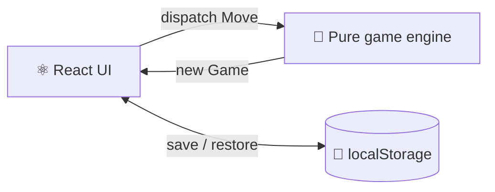

# ⭕❌ Noughts & Crosses

[](https://github.com/saradeclara/noughts-and-crosses-react/actions/workflows/ci.yml)

Classic 3×3 noughts and crosses, built with React and TypeScript. Play a friend on the same device, or take on a computer opponent that never loses. 🤖

> 🚧 **Work in progress.** The project is scaffolded and the design is agreed. The game itself is being built next. See the [roadmap](#-roadmap).

## ✨ Features

- 👥 **Two Player**: two people take turns on the same device.
- 🤖 **vs Computer**: you pick X or O and play a computer that uses minimax. The best you can do is a draw!
- 🏆 **Winning line highlighted** when someone gets three in a row.
- 💾 **Survives a refresh**: the current game is saved in your browser, so reloading the page picks up where you left off.
- ♿ **Accessible**: you can play entirely by keyboard, and screen readers announce each move and the result.

## 🧠 How it's built

The game rules live in a pure TypeScript module (`src/game/`) with **no React imports**. It handles moves, win and draw detection, and the computer player, and it's tested on its own. React only renders the current game and sends moves to it, through `useReducer`.



The project's vocabulary (Game, Mark, Cell, Line, Setup…) is defined in [CONTEXT.md](CONTEXT.md), and the code uses the same words.

## 🛠️ Tech stack

| | |
|---|---|
| ⚡ Build | [Vite](https://vite.dev) |
| ⚛️ UI | React 19 + TypeScript |
| 🎨 Styling | CSS Modules |
| 🧪 Unit tests | [Vitest](https://vitest.dev) + [React Testing Library](https://testing-library.com/docs/react-testing-library/intro/) |
| 🎭 End-to-end tests | [Playwright](https://playwright.dev) |
| 🔁 CI | GitHub Actions (lint, typecheck, unit tests and end-to-end tests) |

## 🚀 Getting started

You'll need [Node.js](https://nodejs.org) 22 or later.

```bash
git clone https://github.com/saradeclara/noughts-and-crosses-react.git
cd noughts-and-crosses-react
npm install
npm run dev
```

Then open the URL that Vite prints (usually http://localhost:5173). 🎉

## 📜 Scripts

| Command | What it does |
| --- | --- |
| `npm run dev` | Start the dev server with hot reload |
| `npm run build` | Typecheck and build for production into `dist/` |
| `npm run preview` | Serve the production build locally |
| `npm run lint` | Run ESLint |
| `npm run typecheck` | Run the TypeScript compiler without emitting |
| `npm test` | Run the unit tests once |
| `npm run test:watch` | Run the unit tests in watch mode |
| `npm run test:e2e` | Build, serve, and run the Playwright tests |

> 💡 **Windows:** locally, the end-to-end tests run in your installed Microsoft Edge rather than a downloaded Chromium. CI uses Chromium.

## 🗺️ Roadmap

- [x] 🏗️ Scaffold: Vite, React, TypeScript, Vitest, Playwright and CI
- [x] 📖 Domain glossary ([CONTEXT.md](CONTEXT.md))
- [ ] 🧩 Game engine: moves, win and draw detection
- [ ] 🤖 Computer player (minimax), with a test that it never loses from any position
- [ ] 🎮 Board UI with the Setup panel and status line
- [ ] 💾 Saving and restoring the game across refreshes
- [ ] ♿ Keyboard play and screen-reader announcements
- [ ] 🌍 Deploy to Vercel
